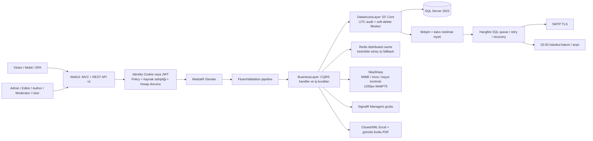

# Staj / Jüri Teslimat ve Kullanım Kılavuzu

14 Ekim 2026 — Modern Spa & Blog Platform, .NET 9.

## Mimari ve işlem akışı



EntityLayer entity/enum'ları tanımlar. DataAccesLayer veritabanı ilişkileri, indeksler, audit ve global filtreleri uygular. BusinessLayer yetki, sahiplik, yaşam döngüsü, yorum moderasyonu, etkileşimler ve CQRS kurallarını yürütür. WebUI controller'ları bu katmana ISender üzerinden ulaşır; API aynı iş kurallarını kullanır.

Halihazırda yayımlanmamış veya silinmiş bloglar halka açık liste/detay/cache sonuçlarına girmez. Public API entity yerine salt-okunur DTO döndürür. Redis kesildiğinde uygulama local cache ile çalışabilir; yayın değişiklikleri DB fingerprint ve cache invalidation ile doğrulanır. Çok replica için ortak Redis, SQL, görsel depolaması ve Data Protection anahtarları kullanılır. Built-in rate limit süreç başınadır; çok instance genel kota için reverse proxy/gateway sınırı da gerekir.

Hangfire işi iletişim mesajı ile teslimat niyeti kaydedildikten sonra kuyruklanır. Gönderilmiş kayıt atlanır; kesinti sonrası lease/recovery ve üç retry uygulanır. SMTP kabulü ile DB işaretleme atomik olmadığından süreç tam arada çökerse mükerrer e-posta ihtimali vardır. Geri yükleme için eski blog görselleri diskte korunur.

## Yetki matrisi

Visitor anonimdir; Identity hesabı veya Visitor rolü bulunmaz. Diğer profiller aktif ve kilitsiz hesap varsayımıyla listelenmiştir.

| İşlem | System Admin | Content Manager / Editor | Author | Moderator | Registered User | Visitor |
|---|---|---|---|---|---|---|
| Published blogları / onaylı yorumları okuma | Evet | Evet | Evet | Evet | Evet | Evet |
| Blog taslağı oluşturma | Evet | Evet | Evet | Hayır | Hayır | Hayır |
| Yönetimde blog listeleme / düzenleme / silme | Tüm kayıtlar | Tüm kayıtlar | Kendi kayıtları | Hayır | Hayır | Hayır |
| İncelemeye gönderme | Evet | Evet | Kendi kayıtları | Hayır | Hayır | Hayır |
| Published / Rejected durumuna geçirme | Evet | Evet | Hayır | Hayır | Hayır | Hayır |
| Blog çöp kutusu / restore | Evet | Evet | Hayır | Hayır | Hayır | Hayır |
| Kategori ve site içerik yönetimi | Evet | Evet | Hayır | Hayır | Hayır | Hayır |
| Yorum / bir alt yanıt oluşturma | Evet | Evet | Evet | Evet | Evet | Hayır |
| Kendi yorumunu düzenleme / silme | Evet | Evet | Evet | Evet | Evet | Hayır |
| Başkasının yorumunu moderasyonla silme / onaylama | Evet | Hayır | Hayır | Evet | Hayır | Hayır |
| Favori / Like / Heart / Clap | Evet | Evet | Evet | Evet | Evet | Hayır |
| Kendi profil / şifre / avatar / favoriler | Evet | Evet | Evet | Evet | Evet | Hayır |
| Üye kilitleme / kilit açma | Evet | Hayır | Hayır | Evet, admin hariç | Hayır | Hayır |
| Rol atama / sistem ayarları | Evet | Hayır | Hayır | Hayır | Hayır | Hayır |
| İletişim mesajları / Excel-PDF raporu | Evet | Evet | Hayır | Evet | Hayır | Hayır |
| Blog / kullanıcı / etkileşim istatistik raporu | Evet | Hayır | Hayır | Hayır | Hayır | Hayır |
| SignalR Managers bildirimlerini dinleme | Evet | Evet | Hayır | Evet | Hayır | Hayır |
| Hangfire dashboard / retry yönetimi | Evet | Hayır | Hayır | Hayır | Hayır | Hayır |

Kilitli/inaktif üyeler yorum ve etkileşim yapamaz; profil/API korumalı işlemlerden de engellenir. Mevcut JWT her istekte veritabanındaki aktiflik, kilit, güvenlik mührü ve rollerle tekrar denetlenir. URL'den başka yazar ID'si girmek sahiplik kontrolünü atlatmaz. Tüm tarayıcı mutasyonlarında antiforgery uygulanır; doğrulanmış Bearer işlemlerinde cookie CSRF token'ı gerekmez.

## Hızlı başlatma

Gereksinimler: çalışan Docker Linux motoru, Docker Compose v2, x64 platform. SQL Server 2022 imajı için uygun lisans/edition gerekir; varsayılan Developer yalnızca geliştirme/demo içindir.

Bir defalık ayar:

```powershell
Copy-Item .env.example .env
```

`.env` dosyasındaki üç SQL parolasını birbirinden farklı, güçlü ve rastgele değerlerle doldurun. `JWT_SIGNING_KEY` en az 32 baytlık rastgele bir anahtar olmalıdır. İlk yönetici için `BOOTSTRAP_ADMIN_EMAIL` ve `BOOTSTRAP_ADMIN_PASSWORD` birlikte verilir; mevcut yöneticinin parolası yeniden yazılmaz. `.env` Git'e eklenmez. SMTP/CAPTCHA startup için isteğe bağlıdır; gerçek iletişim gönderimi için ayrıca yapılandırılır.

Tek komut:

```powershell
docker compose up -d --build
```

Eski Compose komutu kuruluysa `docker-compose up -d --build` karşılığı kullanılabilir. İmaj daha önce derlenmişse istenen kısa biçim `docker-compose up -d` veya `docker compose up -d` yeterlidir.

Yerel compose adresi: `http://localhost:5158`. Lokal .NET Development adresi: `http://localhost:5157`. SQL/Redis yalnızca loopback portlarından yayımlanır. Compose SQL ve Redis sağlıklarını bekler; tek seferlik `migrate` başarıyla bitince webui açılır. Migrator DDL hesabı kısa ömürlüdür; uzun süre çalışan webui SQL SA veya db_owner kullanmaz. SQL verisi, Redis AOF, görseller, günlükler ve Data Protection anahtarları volume'larda korunur.

Compose Production ortamında demo hesapları oluşturulmaz. Yerel Development seeder hesapları admin/editor/author/moderator/user `@spa.com`, şifre `P@ssword123!` şeklindedir. Jüri için hazırlanmış demo içeriği bu ortamda kullanılabilir.

HTTPS canlı dağıtımda `LOCAL_HTTP=false` ayarlayın, TLS reverse proxy kurun ve yalnız gerçek proxy IP'sini `TRUSTED_PROXY_IP` olarak belirtin. HTTPS cookie politikası açık kalır. `SWAGGER_ENABLED=false` varsayılandır; jüri/demo veya kontrollü ortam için açıkça true yapılabilir. Anahtar/volume yedekleri ve erişim izinleri saklama politikasıyla yönetilir. Ayrıntılar [Dağıtım Kılavuzu](DEPLOYMENT.md) içinde.

## API kullanımı

- `GET /api/v1/blogs?pageIndex=1&pageSize=20&categoryId=1&search=spa`
- `GET /api/v1/blogs/{slug}?commentsPageIndex=1&commentsPageSize=10`
- `GET /api/v1/categories`
- `POST /api/v1/auth/login` — JSON `email` ve `password`; yanıt `data.accessToken`.
- `GET /api/v1/auth/me` — geçerli cookie veya Bearer.
- `POST /api/v1/blogs`, `PUT /api/v1/blogs/{id}`, `DELETE /api/v1/blogs/{id}`.
- `POST /api/v1/comments` — JSON `blogId`, `content`, isteğe bağlı `parentCommentId`.
- `PUT /api/v1/comments/{id}`, `DELETE /api/v1/comments/{id}` — sahiplik/moderasyon kuralları korunur.

Blog JSON alanları `title`, `subTitle`, `content`, `categoryId` şeklindedir. API yazar ID'si, audit veya yayın durumunu istemciden kabul etmez. Oluşturma Draft döner; yayın incelemesi yönetim panelinden yapılır. Başarılı yanıtlar `success/message/data/errors/statusCode` sarmalayıcısını kullanır. Hatalar `application/problem+json` olur; 400/401/403/404/409/413/429/500 durumlarında HTML hata sayfası dönmez. API kotası varsayılan 60 istek/dakika, aktif kullanıcı veya anonim IP başınadır; aşımda Retry-After ile 429 döner.

Swagger: `/swagger`; OpenAPI: `/swagger/v1/swagger.json`. Login yanıtındaki token'ı Swagger Authorize kutusuna girin. Token'ları ekran görüntüsü veya logla paylaşmayın. Endpoint/DTO XML açıklamaları ve Bearer şeması dokümantasyona dahildir; proje lisansı belirtilmemişse Swagger bunu açıkça gösterir.

## Beş dakikalık jüri demosu

Ön hazırlık: Development ortamında yayımlanmış bir blog ve en az bir kategori hazır olsun; iki ayrı tarayıcı profili kullanın. Birinde editor/admin, diğerinde Registered User oturumu açın. Swagger sayfasını ve Hangfire dashboard'u önceden hazırlayın.

1. **0:00–0:40 — Mimari ve API:** Swagger'da kategori/search/sayfalama ile public GET çalıştırın. Wrapper DTO'yu ve Draft'ın görünmediğini gösterin. Diagram üzerinde controller → ISender → validation → handler → EF akışını açıklayın.
2. **0:40–1:30 — Güvenli içerik ve WebP:** Author veya admin ile bir JPG/PNG yükleyerek taslak oluşturun. Yeni `uploads/blogs/*.webp` dosyasını, en fazla 1200px genişliği ve XSS temizliğini gösterin. Editor ile yayımlayın; anonim detayın açıldığını doğrulayın.
3. **1:30–2:20 — Canlı moderasyon:** Üye profilindeki tarayıcıdan bir yorum gönderin. Yönetici ekranında Managers SignalR bildiriminin gelmesini gösterin. Yorum onaylanmadan public listede yoktur; Moderator onayı sonrası görünür. Bir alt yanıtı gösterin; üçüncü seviyenin reddedildiğini açıklayın.
4. **2:20–3:10 — Rol ve sahiplik:** Author token'ı ile başka yazarın bloguna PUT yapıp 403 Problem Details gösterin. Moderator'ın rol yönetimine giremediğini, üye kilitleyebildiğini gösterin; kilitli mevcut token yorum yazamaz. Demo sonunda kilidi açın.
5. **3:10–4:00 — Etkileşim ve rapor:** Üye favori/Heart uygulasın; profil favorilerinde görünsün. Admin blog/etkileşim Excel raporunu indirsin; filtreli sütunları ve PDF Türkçe karakterlerini gösterin.
6. **4:00–5:00 — Güvenilirlik ve kalite:** Hangfire recurring görevlerini/Failed-Scheduled retry örneğini açın. SMTP kesintisinde mesajın DB'de kaldığını açıklayın. Son test sayısını, BusinessLayer ≥70% kalite kapısını, log maskelemesini ve non-root Docker dağıtımını gösterin.

SMTP demosu kontrollü yerel kapalı SMTP ile hazırlanmalıdır; sunum sırasında gerçek alıcılara deneme e-postası gönderilmez. Bildirimler Clients.All yerine Managers grubuna gider. Demo token/şifrelerini projeksiyon ekranındaki loglardan uzak tutun.

## Test ve teslimat dosyaları

```powershell
pwsh -NoProfile -File scripts/Test-QualityGate.ps1
```

Bu komut tüm testleri Release olarak çalıştırır; BusinessLayer assembly'nin bütün üretim tipleri için coverlet ölçümü alır ve %70 altında başarısız olur. Windows TRX attachment kopyalarının yalnızca byte-identical olanları kabul edilir. Gerçek test/kapsam JSON ve Cobertura kanıtları `.artifacts/quality/{run-id}` altında, final teslimat özeti `docs/ASAMA_4_FINAL_TESLIMAT_RAPORU.md` içinde bulunur.

GitHub kalite workflow'u aynı kapıyı Linux'ta çalıştırıp Docker imajını build eder ve kanıtları artifact olarak saklar. Workflow dosyası teslimata dahildir; gerçek CI çalıştırılması repository'ye push gerektirir. Güncel test sonuçları ve container doğrulamasının gerçekleşen kapsamı final raporda ayrı belirtilir.
